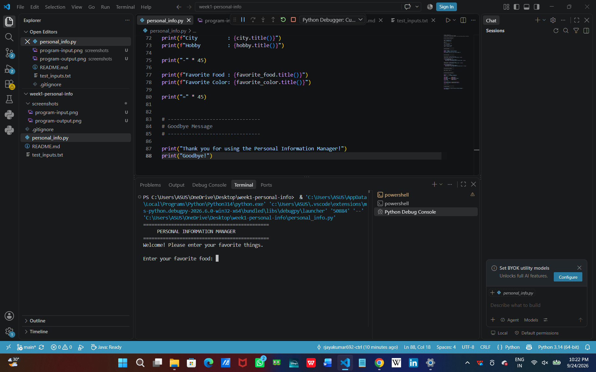
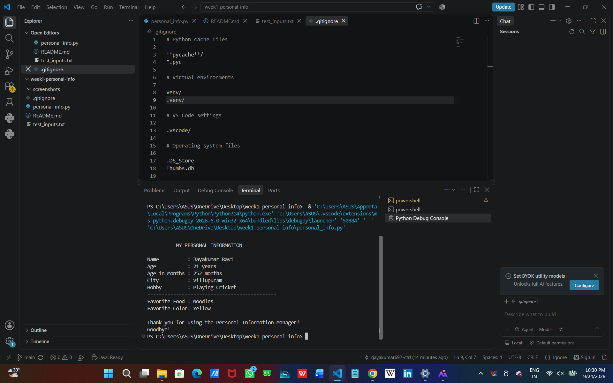

# Personal Information Manager

## Project Description

This is my first Python project! It is a simple **Personal Information Manager** that stores and displays personal information.

The program demonstrates basic Python concepts such as variables, user input, input validation, string methods, calculations, and formatted output.

---

## Project Overview

The Personal Information Manager stores basic personal information such as:

* Name
* Age
* City
* Hobby
* Favorite Food
* Favorite Color

Some information is stored directly in variables, while the favorite food and favorite color are entered by the user during program execution.

## Objectives

The main objectives of this project are:

* Practice Python variables and data types.
* Learn how to accept user input.
* Practice input validation.
* Use string methods to format text.
* Use f-strings for formatted output.
* Perform a basic calculation using the user's age.
* Create a complete beginner-level Python program.

---

## What I Learned

1. **Variables**: How to store different types of data.
2. **Input/Output**: Getting user input and displaying results.
3. **String Formatting**: Using f-strings to create formatted output.
4. **Error Handling**: Performing basic validation for user input.
5. **String Methods**: Using methods such as `.strip()` and `.title()`.
6. **Loops**: Using a `while` loop to repeatedly ask for valid input.
7. **Arithmetic Operations**: Calculating age in months.

---

## Technologies Used

* Python 3
* Visual Studio Code
* Git
* GitHub

---

## Project Structure

```text
week1-personal-info/
│
├── personal_info.py
├── README.md
├── test_inputs.txt
└── .gitignore
```

### File Description

| File               | Description                                         |
| ------------------ | --------------------------------------------------- |
| `personal_info.py` | Main Python program                                 |
| `README.md`        | Project documentation                               |
| `test_inputs.txt`  | Test cases used during testing                      |
| `.gitignore`       | Files and folders that should not be tracked by Git |

---

## Code Structure Explanation

The Python program is divided into several sections:

### 1. Static Personal Information

Variables are used to store the name, age, city, and hobby.

```python
name = "Jayakumar Ravi"
age = 21
city = "Villupuram"
hobby = "Playing Cricket"
```

### 2. User Input

The program asks the user to enter their favorite food and favorite color.

```python
favorite_food = input("Enter your favorite food: ").strip()
favorite_color = input("Enter your favorite color: ").strip()
```

### 3. Input Validation

The program checks whether the user entered empty input.

```python
while not favorite_food:
    print("Favorite food cannot be empty.")
    favorite_food = input("Please enter your favorite food: ").strip()
```

The same validation is used for the favorite color.

### 4. Age Calculation

The program calculates the person's age in months.

```python
age_in_months = age * 12
```

### 5. Formatted Output

The program uses f-strings and string methods to display the information clearly.

```python
print(f"Name          : {name.title()}")
print(f"Age in Months : {age_in_months} months")
```

---

## How to Run This Program

### Prerequisites

Make sure Python 3 is installed on your computer.

You can check the Python installation by running:

```bash
python --version
```

### Steps

1. Clone or download this repository.
2. Open the project folder in VS Code or a terminal.
3. Navigate to the project folder.
4. Run the following command:

```bash
python personal_info.py
```

5. Follow the prompts to enter your favorite food and favorite color.

---

## Features

* Stores static information such as name, age, city, and hobby.
* Gets dynamic information from the user.
* Accepts favorite food and favorite color.
* Validates empty user input.
* Displays all personal information in a formatted way.
* Calculates age in months.
* Uses f-strings for output formatting.
* Uses string methods such as `.strip()` and `.title()`.
* Displays welcome and goodbye messages.

---

## Technical Requirements

| Requirement                               | Implementation                              |
| ----------------------------------------- | ------------------------------------------- |
| At least 4 personal information variables | Name, age, city, hobby                      |
| At least 2 user inputs                    | Favorite food and favorite color            |
| Formatted output                          | f-strings and separators                    |
| Comments                                  | Comments are included throughout the code   |
| Input validation                          | Empty input is checked using a `while` loop |
| String methods                            | `.strip()` and `.title()` are used          |
| Age calculation                           | Age is multiplied by 12                     |
| Welcome message                           | Displayed when the program starts           |
| Goodbye message                           | Displayed when the program ends             |

---

## Sample Output

```text
=============================================
     PERSONAL INFORMATION MANAGER
=============================================
Welcome! Please enter your favorite things.

Enter your favorite food: Biryani
Enter your favorite color: Blue

=============================================
          MY PERSONAL INFORMATION
=============================================
Name          : Jayakumar Ravi
Age           : 21 years
Age in Months : 252 months
City          : Villupuram
Hobby         : Playing Cricket
---------------------------------------------
Favorite Food : Biryani
Favorite Color: Blue
=============================================
Thank you for using the Personal Information Manager!
Goodbye!
```

---

## Screenshots

### 1. Program Input

Screenshot showing the program asking for favorite food and favorite color.



### 2. Program Output

Screenshot showing the completed personal information output.



---

## Testing

The program was tested using different types of input.

### Test Case 1: Normal Input

```text
Favorite Food: Biryani
Favorite Color: Blue
```

**Expected Result:** Personal information is displayed correctly.

### Test Case 2: Empty Input

```text
Favorite Food:
```

**Expected Result:** The program displays an error message and asks for the input again.

### Test Case 3: Input With Extra Spaces

```text
Favorite Food:   Fried Rice
Favorite Color:   Green
```

**Expected Result:** Extra spaces are removed using `.strip()`.

### Test Case 4: Different Input

```text
Favorite Food: Pizza
Favorite Color: Red
```

**Expected Result:** The new values are displayed correctly.

### Test Case 5: Long Input

The program was tested with longer food and color names to verify that the program continues to accept user input.

---

## Challenges & Solutions

### Challenge 1: User might enter empty input

**Solution:** Added input validation using a `while` loop to check whether the input is empty.

### Challenge 2: Formatting the output nicely

**Solution:** Used f-strings, separators, and string methods to create readable output.

### Challenge 3: Removing unnecessary spaces from user input

**Solution:** Used the `.strip()` string method.

### Challenge 4: Displaying text in a consistent format

**Solution:** Used the `.title()` string method when displaying text.

---

## Conclusion

This project helped me practice the fundamentals of Python by building my first complete Python program.

I learned how to work with variables, user input, validation, string methods, calculations, loops, comments, and f-string formatting.
